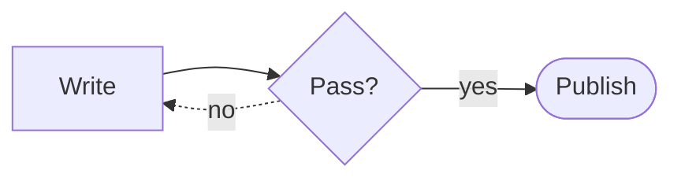
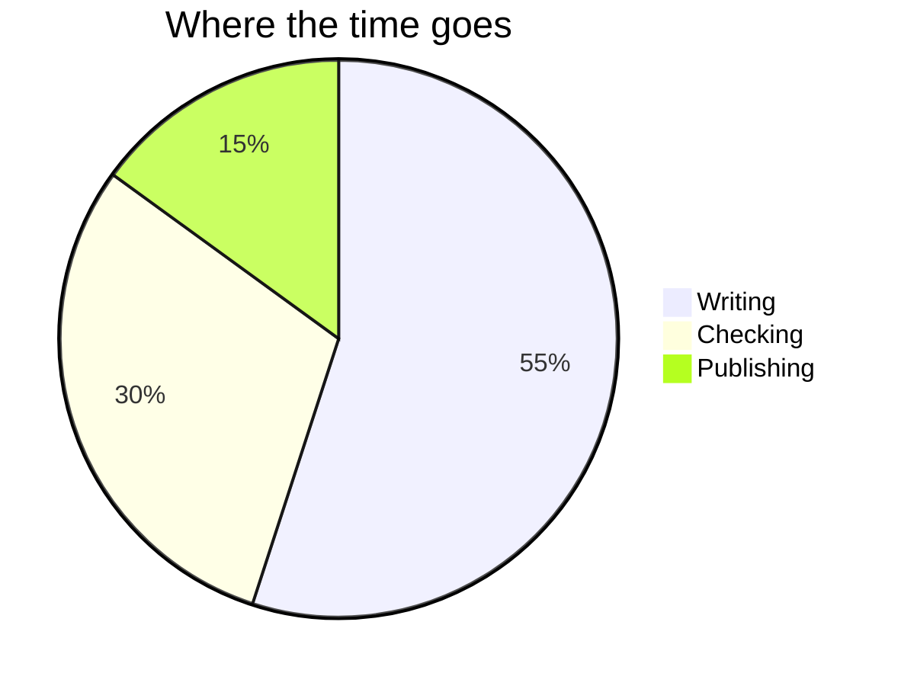

# Markdown

What a Markdown document gives on a page of the site. Each example shows its source, then its
result.

## Alerts

An alert is a block quote that starts with a kind. GitHub draws it the same way.

```
> [!NOTE]
> A note, with the colour of its kind.

> [!WARNING]
> A warning.
```

> [!NOTE]
> A note, with the colour of its kind.

> [!WARNING]
> A warning.

## Tables and task lists

```
| Theme | Look                   |
| ----- | ---------------------- |
| docs  | a menu on each side    |
| paper | one column of text     |

- [x] Write the page
- [ ] Publish it
```

| Theme | Look                |
| ----- | ------------------- |
| docs  | a menu on each side |
| paper | one column of text  |

- [x] Write the page
- [ ] Publish it

A table wider than the page scrolls inside its own box.

## Footnotes

```
A claim with a note.[^1]

[^1]: The note goes to the end of the page.
```

A claim with a note.[^1]

[^1]: The note goes to the end of the page.

## Code

A code block keeps its language and has a button that copies it.

~~~
```rust
fn main() {
    println!("hello");
}
```
~~~

```rust
fn main() {
    println!("hello");
}
```

## Diagrams

A block of the language `diagram` is drawn as an SVG figure, in the colour of the text. It stays
plain text on GitHub and in the terminal.

~~~
```diagram
cmd arg
|---|
  a _/
```
~~~

```diagram
cmd arg
|---|
  a _/
```

## Mermaid

A `mermaid` block is drawn as an SVG figure, as GitHub draws it, with no script on the page.
Flowcharts, sequence diagrams, state diagrams, class diagrams, entity-relationship diagrams and pie
charts are drawn. A block of another kind stays a code block.

~~~

~~~





## Links

A relative link to another document becomes a link to its page, with its anchor, so the documents
read the same on GitHub and on the site. See [the widgets](widgets.md#tabs) and [the
themes](themes.md).

Every heading is a link to itself, and the search palette (press `/`) finds a page or a section by
its title.
