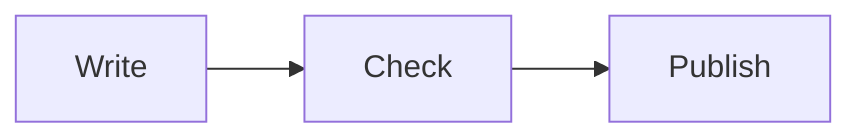

# In the terminal

`dkt cat` draws a document as styled text, with colours, table borders, alerts and diagrams. The
source is the one the site shows on its pages.

The source of the example:

~~~
# Release notes

A short document, read in the terminal.

> [!TIP]
> Pipe the output to a pager with `dkt cat -p`.

| Step    | State   |
| ------- | ------- |
| build   | done    |
| publish | pending |

- [x] Write the notes
- [ ] Tag the release

```rust
fn main() {
    println!("hello");
}
```


~~~

Run in a terminal that draws 24-bit colours, `COLORTERM=truecolor dkt cat --color always --width 72 --borders unicode examples/terminal/sample.md` writes this. The block holds the escape sequences of the terminal, and the site draws their colours. A terminal adds the links, and a pager keeps the colours with `less -R`.

```ansi
# Release notes

A short document, read in the terminal.

│ TIP
│
│ Pipe the output to a pager with dkt cat -p.

┌─────────┬─────────┐
│ Step    │ State   │
├─────────┼─────────┤
│ build   │ done    │
├─────────┼─────────┤
│ publish │ pending │
└─────────┴─────────┘

• [✓] Write the notes
• [ ] Tag the release

  fn main() {
      println!("hello");
  }

  ┌───────┐     ┌───────┐     ┌─────────┐
  │ Write ├────►│ Check ├────►│ Publish │
  └───────┘     └───────┘     └─────────┘
```

A Mermaid block is drawn with box characters, as above, for flowcharts, sequence diagrams, state
diagrams, class diagrams, entity-relationship diagrams and pie charts.

Other options of the command:

| Option                   | Effect                                            |
| ------------------------ | ------------------------------------------------- |
| `--soft-breaks preserve` | keep each line of the source                      |
| `--toc`                  | list the outline of the document with its anchors |
| `--section HEADING`      | draw one section                                  |
| `-p`                     | send the output to a pager                        |

See [dkt cat](../docs/cat.md) for all of them.
