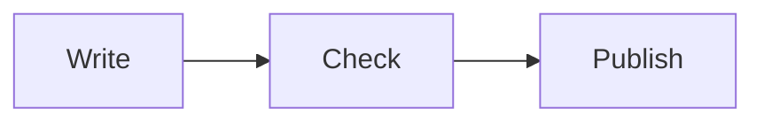

# Release notes

A short document, read in the terminal.

> [!TIP]
> Pipe the output to a pager with `dkt cat -p`.

| Step    | State   |
| ------- | ------- |
| build   | done    |
| publish | pending |

- [x] Write the notes
- [ ] Tag the release

```rust
fn main() {
    println!("hello");
}
```


