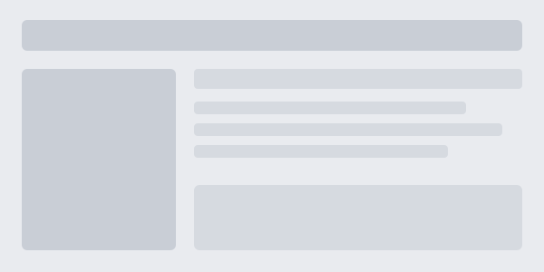
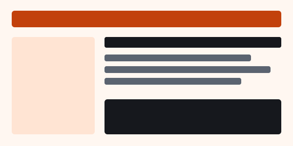

# Widgets at work

Every widget of [the reference](../docs/widgets.md) in action. Each section shows the source of a
widget, then its result. The reference gives the options, what is remembered and what happens
without the script.

## Tabs

The shallowest heading level inside the widget gives the tabs. A block before the first heading
stays above them.

<!-- site: widget tabs id=install -->

### cargo

```
cargo install --path .
```

### From the source

```
git clone https://github.com/cbonte/dkt
cd dkt
cargo build --release
```

<!-- site: end -->

```
<!-- site: widget tabs id=install -->
### cargo

...

### From the source

...
<!-- site: end -->
```

## Checklist

The boxes of the list can be ticked, and a bar counts them.

<!-- site: widget checklist id=start -->

- [ ] Write a `dkt.toml`
- [ ] Add a `[[page]]` for each document
- [ ] Run `dkt site`

<!-- site: end -->

## Steps

Each step has a button to mark it done. The first step not done is highlighted.

<!-- site: widget steps id=publish -->

1. Build the site with `dkt site`.
2. Read the pages in the output directory.
3. Publish the directory.

<!-- site: end -->

## Quiz

`answer` is the position of the right choice, from 1. What follows the list shows once the reader
has chosen.

<!-- site: widget quiz answer=2 id=format -->

Which format does `dkt fmt` read?

1. reStructuredText
2. Markdown
3. A documentation text of HAProxy

It reads Markdown only. The other commands read the 3 formats.

<!-- site: end -->

## Carousel

A thematic break (3 hyphens on a line) cuts the slides.

<!-- site: widget carousel id=tour -->

**Write.** The documents stay as GitHub shows them.

---

**Check.** `dkt lint` reports the links and anchors that do not hold.

---

**Publish.** `dkt site` builds the pages, the search and the menus.

<!-- site: end -->

The slides are a row that the page scrolls, so the row scrolls by touch and by the keys of the
arrows, and it scrolls without JavaScript. Options on the annotation set the rest.

| Option          | Effect                                                                   |
| --------------- | ------------------------------------------------------------------------ |
| `show="1 2 3"`  | the slides in view on a narrow page, from 640 pixels and from 960 pixels |
| `loop`          | the row never ends                                                       |
| `autoplay=4500` | scroll by itself, with this delay in milliseconds, and a button to pause |
| `zoom`          | a click on a picture opens it larger                                     |

The automatic scroll stops when the pointer or the focus is in the carousel, when the tab is hidden,
and for good after the reader acts on it. It does not start for a reader whose system asks for less
motion.

<!-- site: widget carousel id=pictures show="1 2 3" loop autoplay=4500 zoom -->

<!-- site: figure name=favicon alt="The mark of dkt, first" caption="One" -->

---

<!-- site: figure name=favicon alt="The mark of dkt, second" caption="Two" -->

---

<!-- site: figure name=favicon alt="The mark of dkt, third" caption="Three" -->

---

<!-- site: figure name=favicon alt="The mark of dkt, fourth" caption="Four" -->

---

<!-- site: figure name=favicon alt="The mark of dkt, fifth" caption="Five" -->

<!-- site: end -->

A picture comes from `figure`. The images after the ones in view are loaded when the reader gets
near them.

```
<!-- site: widget carousel id=pictures show="1 2 3" loop autoplay=4500 zoom -->
<!-- site: figure name=favicon alt="The first picture" caption="One" -->

---

<!-- site: figure name=favicon alt="The second picture" caption="Two" -->
<!-- site: end -->
```

## Tab groups

Tabs with the same `group` follow each other: the reader who picks a system in one of them gets the
same one in all the others, on this page and on the next ones, and it is remembered.

<!-- site: widget tabs group=system id=build-linux -->

### Linux

```
cargo build --release
```

### macOS

```
cargo build --release
```

### Windows

```
cargo build --release
```

<!-- site: end -->

<!-- site: widget tabs group=system id=run-linux -->

### Linux

```
./target/release/dkt --version
```

### macOS

```
./target/release/dkt --version
```

### Windows

```
.\target\release\dkt.exe --version
```

<!-- site: end -->

## Table

A table that can be filtered with a few words and sorted by a click on a heading. The filter is kept
in the address, so a link can point to a filtered table.

<!-- site: widget table id=providers -->

| Provider  | Kind     | Local |
| --------- | -------- | ----- |
| loken     | native   | yes   |
| ollama    | OpenAI   | yes   |
| vLLM      | OpenAI   | yes   |
| llama.cpp | OpenAI   | yes   |
| Anthropic | Messages | no    |
| OpenAI    | OpenAI   | no    |

<!-- site: end -->

## Compare

2 pictures with a slider between them. The text of the figure, or else the alternative text, names
each side.

<!-- site: widget compare id=restyle -->





<!-- site: end -->

## Diff

A block of the language `diff`, with the added and removed lines coloured, that can also be read
with the 2 sides next to each other.

<!-- site: widget diff id=patch -->

```diff
--- a/src/main.rs
+++ b/src/main.rs
@@ -1,6 +1,7 @@
 fn main() {
-    println!("hello");
-    run();
+    let name = std::env::args().nth(1).unwrap_or_default();
+    println!("hello {name}");
+    run(&name);
 }
```

<!-- site: end -->

## Chart

A table drawn as bars, or as lines with `type=line`, with a button to go back to the table. The
first column names the points and the other columns are the series.

<!-- site: widget chart id=speed -->

| Pages | Before | After |
| ----- | ------ | ----- |
| 10    | 0.8    | 0.1   |
| 50    | 3.9    | 0.4   |
| 100   | 7.9    | 0.8   |

<!-- site: end -->

<!-- site: widget chart type=line id=speed-line -->

| Pages | Before | After |
| ----- | ------ | ----- |
| 10    | 0.8    | 0.1   |
| 50    | 3.9    | 0.4   |
| 100   | 7.9    | 0.8   |

<!-- site: end -->

## Flashcards

A table of 2 columns, the front and the back. A click turns the card, and the cards that the reader
does not know come back. What is known is remembered.

<!-- site: widget flashcards id=terms -->

| Term       | Meaning                                                      |
| ---------- | ------------------------------------------------------------ |
| Widget     | blocks between 2 comments that the site makes a component of |
| Annotation | a comment that starts with `site:`                           |
| Theme      | templates and files that sites share                         |

<!-- site: end -->

## Annotated picture

Numbered pins on a picture, tied to the items of the list that explains them. `pins` gives one
position for each item, as `x,y` in percent of the picture. Pointing at a pin or at an item lights
both, and a click on a pin goes to its item.

<!-- site: widget annotated id=anatomy pins="50,9 16,50 62,37 62,82" -->


1. The header, with the menu of the site.
2. The menu of the section.
3. The text of the page.
4. A block of code, with its copy button.

<!-- site: end -->

## Builder

A form that writes a command or a file. The table gives the fields (a name, a label and the values),
and the code block gives the model with the names between braces. A field with several values is a
choice, and one with a single value is a text that starts as it.

<!-- site: widget builder id=command -->

| Field | Label   | Values                                    |
| ----- | ------- | ----------------------------------------- |
| model | Model   | qwen3-coder:latest, llama3.1:70b, mistral |
| root  | Project | .                                         |
| mode  | Mode    | act, plan                                 |

```
lokode --model {model} --root {root} --mode {mode}
```

<!-- site: end -->

## Replay

A terminal session played back. A line that starts with `$ ` is typed and the other lines appear. It
starts when it comes into view, and not at all for a reader who asks for less motion, who gets the
whole session. `speed` sets how fast it goes.

<!-- site: widget replay id=session speed=1.5 -->

```
$ dkt site dkt.toml -o public
dkt site: 19 pages written to public
$ ls public
commands  examples  index.html  search.json
$ dkt cat --width 40 README.md | head -3
# dkt

Doc Kit (dk:t) is a set of tools for documents.
```

<!-- site: end -->

## Since a version

The headings that start with a version cut the document, and the reader tells which version they
run. Only the versions that come after it stay, and the choice is remembered.

<!-- site: widget since id=news -->

### 0.3.0

- Added the widgets.

### 0.2.0

- Added the examples.

### 0.1.0

- The first release.

<!-- site: end -->

## Progress

What the reader has done in the whole site: the boxes ticked, the steps done, the quizzes answered
and the cards known, page by page, with a bar for all of them. The build writes `widgets.json`,
which says what each page holds, and the widget reads what the browser remembers of each one.
Nothing leaves the browser.

<!-- site: widget progress id=course -->

The progress of the reader appears here.

<!-- site: end -->

A section with `pager = true` also ends each of its pages with links to the previous and to the next
page, as the pages of this section do.

## Copy button

Every code block of the site gets a button that copies it, with or without a widget.
